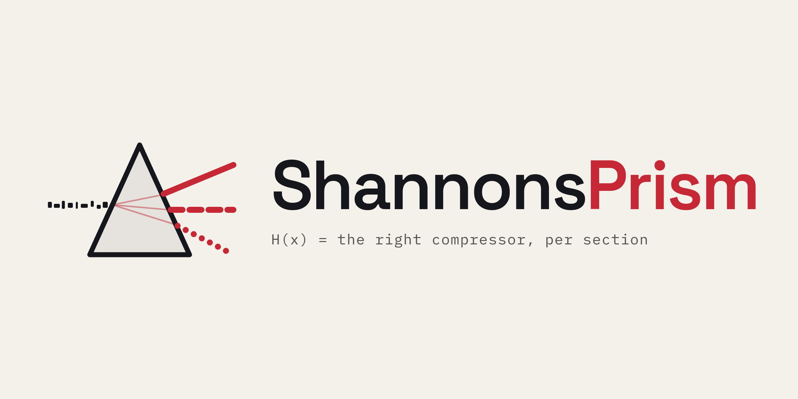
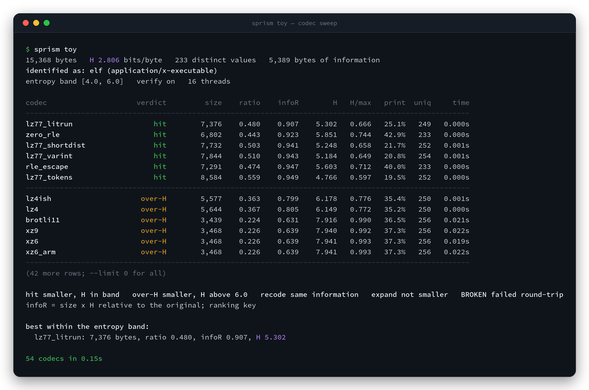
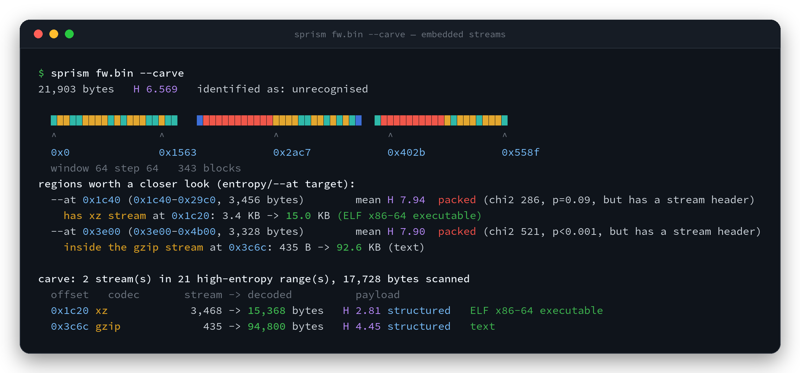
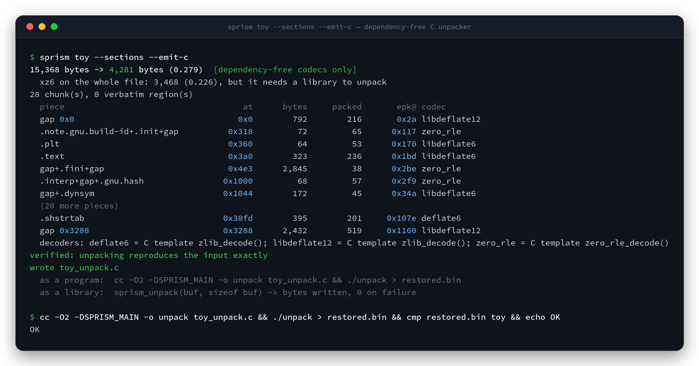

<div align="center">

<picture>
  <source media="(prefers-color-scheme: dark)" srcset="docs/assets/logo-dark.png">
  
</picture>

<p>
  <a href="#red-and-blue">Red and Blue</a> ·
  <a href="#install">Install</a> ·
  <a href="#usage">Usage</a> ·
  <a href="#reading-the-table">Reading the table</a> ·
  <a href="#structure-streams-and-packing">Structure, streams and packing</a> ·
  <a href="#codecs">Codecs</a> ·
  <a href="#license">License</a>
</p>

<p>
  
  
  
  
  
  
</p>

</div>

**ShannonsPrism** shows you what a binary is made of and what compression can honestly do to it. Point `sprism` at a file and it runs 83 codecs, decodes every result for proof, and ranks them by information removed. Use it to pick the right codec per section when building an SDK or firmware image, to pack a binary and emit a dependency-free C unpacker for it, or to pull the compressed streams out of an unknown blob and see what they hold.

Structured inputs are ELF, PE, COFF, and Mach-O (COFF is still being tested). Wasm and XCOFF parse too. `sprism` finds the xz, gzip, zstd, lz4, bzip2, and zlib streams inside and decodes them. Built-in decoders are tested with truncated and bit-flipped encodings. Library decoders are tested with hostile buffers, so a bad stream fails that codec instead of aborting the process.

A `.bin` file or other flat firmware image has no object header, so it is a raw blob. A plain sweep, `--carve`, and whole-file `--pack` all run on it. `--sections` needs a recognised object header and exits otherwise. `--sections --pack` and `--sections --emit-c` fall back to the entropy map when there is no section table.

<p align="center">
  
</p>


## Red and Blue

Red teams are invited to use ShannonsPrism to custom-encode and pack payloads. `--pack` writes a `.epk` with the codec named, for the whole file or one codec per section. `--emit-c` writes a dependency-free C unpacker that contains only the decoders that package needs.

Blue teams are invited to use the same sweep on a sample or firmware image: which regions carry information, which codec actually shrinks them, and which compressed streams `--carve` can decode and identify.


## Install

```bash
cargo install --git https://github.com/0xtengu/ShannonsPrism --locked
```

Or from a checkout:

```bash
cargo build --release                                       # target/release/sprism, ~4 MB
cargo build --release --target x86_64-unknown-linux-musl    # fully static
cargo test --release                                        # 49 tests
```

> [!NOTE]
> bzip3 is always included and needs libclang at build time. The bundled
> LZHAM backend also needs CMake and a C++ compiler.

LZSA 1.4.1, UCL 1.03, LZRW and LZHAM are bundled and compiled from C/C++ for
reproducible builds. Their upstream license notices are retained under `vendor/`.
`Cargo.lock` is committed, and `--locked` installs those exact Rust dependency versions.

## Usage

The flags below combine freely: 

**Look**

```bash
sprism fw.bin                          # sweep all codecs, rank by information removed
sprism prog.elf --sections             # entropy map, then one row per section
sprism prog.elf --sections --section .text --section .rodata   # just those sections
sprism prog.elf --list-sections        # the section names to pass to --section
sprism fw.bin --at 0x4c00 --len 4096   # hex dump, entropy profile and best codec for one range
sprism ./samples                       # rank every file in a directory by how random it looks
sprism --list                          # the codecs this build carries
```

**Carve**

```bash
sprism fw.bin --carve                  # find and decode embedded compressed streams
sprism fw.bin --carve --out payloads   # also write each decoded payload to payloads/
```

**Pack**

```bash
sprism fw.bin --pack                              # one codec for the whole file  -> fw.bin.epk
sprism prog.elf --sections --pack                 # best codec per section        -> prog.elf.epk
sprism fw.bin --sections --pack                   # no section table: entropy-map regions
sprism prog.elf --sections --pack --out fw.epk    # choose the output path
sprism prog.elf --sections --pack --pick low-entropy  # per piece, prefer the lowest-entropy output
sprism --unpack fw.epk --out fw.restored.bin      # back to the original bytes (stdout without --out)
```

**Emit C**

```bash
sprism fw.bin --emit-c                            # small C decoder + separate fw.bin.epk
sprism prog.elf --sections --emit-c --out unpack.c  # writes unpack.c and unpack.epk
```

## Output

| flag | effect |
| :-- | :-- |
| `--json` | machine-readable output for `--sections`, `--carve`, `--pack`, `--emit-c` and directory scans |
| `--sort score\|info\|ratio\|size\|entropy\|time\|name` | order of the codec table (default `score`) |
| `--limit N` | rows to print, `0` for all (default 30) |
| `--band LOW:HIGH` | entropy band in bits per byte that separates `hit` from `over-H` (default `4:6`) |
| `--pick size\|low-entropy\|high-entropy` | how the best codec per piece is chosen; only codecs that shrink the piece are eligible |
| `--threads N`, `--max-size MB` | worker threads, and the input size the sweep refuses (default 512 MB) |
| `--exhaustive` | include maximum-ratio/very-slow variants in whole-file sweeps above 8 MiB; faster representatives of their families remain enabled |

## Reading the table

| column | meaning |
| :-- | :-- |
| `infoR` | `size × H` relative to the original: an empirical order-0 estimate used as the ranking key. It resists simple alphabet expansions such as hex, but is not invariant under every reversible transform. |
| `H`, `H/max` | entropy of the output in bits per byte, and entropy relative to the output's own alphabet. `H/max` near 1.0 means incompressible as it stands. |
| `print`, `uniq` | printable fraction and distinct byte values of the output |

| verdict | meaning |
| :-- | :-- |
| `hit` | smaller, less information, entropy inside the band |
| `over-H` | smaller, entropy above the band |
| `recode` | entropy looks lower, but the order-0 estimate did not improve |
| `expand` | not smaller |
| `BROKEN` | failed the round trip |

> [!NOTE]
> Why not rank on entropy? Hex caps `H` at 4.0 and base64 at 6.0, so a table sorted by entropy would put every text encoding at the top. Ranking on `infoR` puts them in `recode`.

## Structure, streams and packing

`--sections` reports and labels each region with an overall entropy map. For random-like regions, a chi-square test reports `uniform-like high entropy` or `nonuniform high entropy`; these are statistical descriptions, not claims that the bytes are encrypted or compressed. Those causes require stronger evidence such as a recognized stream signature, successful decompression, or structural context. Object metadata adds import/export totals, named symbols, and functions identified by text symbols, with symbol/function counts attributed to each section. JSON output includes the corresponding records. Functions are never inferred from instruction bytes: stripped-function recovery, control flow, and disassembly remain intentionally out of scope. Each section then gets its own row with its band, best codec and packed size, and the report closes by comparing per-section packing with one-blob packing.

`--carve` searches the high-entropy regions for zlib, gzip, xz, zstd, lz4 and bzip2 headers, decodes, reports, and attempts to identify. LZMA-alone and raw deflate have no magic, so they are probed blind where entropy steps up. Every payload is carved once more.

<p align="center">
  
</p>

`--pack` writes one codec for the whole file. With `--sections` it splits along the section table, or along the entropy map when there is none, sweeps, and writes a `.epk` with codecs named. Nothing is written until the package verifies the input.

`--emit-c` limits the sweep to 41 codecs with dependency-free C decoders and writes a compact C function plus a separate `.epk`. The C contains only the selected decoders and package offsets; it never embeds the original or compressed payload. Call `sprism_unpack(epk, epk_len, out, out_len)`. It uses no includes or allocation, and an FNV-1a checksum makes it fail rather than return wrong bytes. The report also shows what the best library codec would have achieved, so the cost of going dependency-free is visible.

<p align="center">
  
</p>


## Codecs

| family | codecs | C decoder |
| :-- | :-- | :-- |
| built-in transforms | `dpcm` `xor_prev` `delta16` `mtf` `bitplane_split` | all |
| built-in RLE | `rle_pair` `rle_escape` `zero_rle` `packbits` | all |
| built-in LZ | `lzss` `lz77_tokens` `lz77_shortdist` `lz77_varint` `lz77_litrun` `lz4ish` `lz77_ascii_tokens` | all |
| embedded | `heatshrink` `lzsa2` | all |
| built-in dictionary and entropy | `bpe` `rans` `dpcm_rans` `mtf_rans` `bitplane_rans` | all |
| Density | `density_chameleon` `density_cheetah` `density_lion` | |
| deflate | `deflate1` `deflate6` `deflate9` `zopfli` `libdeflate6` `libdeflate12` | yes |
| BWT | `bz2_1` `bz2_9` `bzip3` | |
| LZMA | `lzma_alone` `xz0` `xz6` `xz9` plus BCJ filters `xz6_x86` `xz9_x86` `xz6_arm` `xz6_thumb` `xz6_ppc` `xz6_sparc` `xz6_ia64` | |
| zstd | `zstd1` `zstd3` `zstd9` `zstd19` `zstd22` | |
| brotli | `brotli5` `brotli9` `brotli11` | |
| fast LZ | `lz4` `snappy` `lzo1x` `lzf` `lzfse` `quicklz1` `quicklz3` `lzav` `lzav_hi` `lzjb` `lzjb9` `brieflz1` `brieflz5` `brieflz10` | `lz4` `snappy` `lzo1x` `lzf` `lzjb` `lzjb9` `brieflz1` `brieflz5` `brieflz10` |
| LZRW | `lzrw1` `lzrw1a` `lzrw2` `lzrw3` `lzrw3a` `lzrw5` | |
| LZHAM | `lzham_fast` `lzham` `lzham_uber` | |
| UCL NRV | `nrv2b` `nrv2d` `nrv2e` | all |
| dictionary and context | `lzw` `ppmd_o6` `ppmd_o16` | |

## License

ShannonsPrism is free software: you can redistribute it and/or modify it under the terms of the GNU General Public License as published by the Free Software Foundation, either version 2 of the License, or (at your option) any later version. See `LICENSE`.

Bundled codecs keep their own upstream licenses under `vendor/`. Space Grotesk and IBM Plex Mono, used to build the logo, are under the SIL Open Font License; the notices are `docs/brand/OFL-SpaceGrotesk.txt` and `docs/brand/OFL-IBMPlex.txt`.


